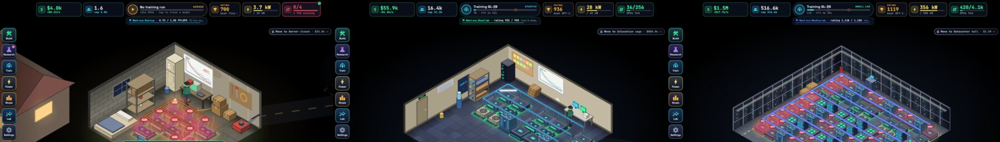
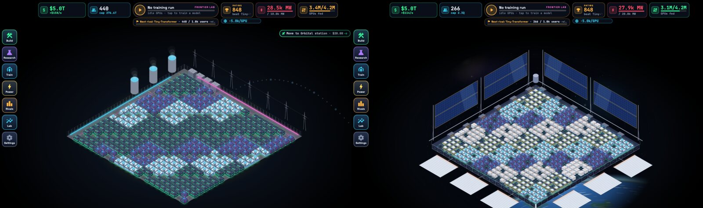
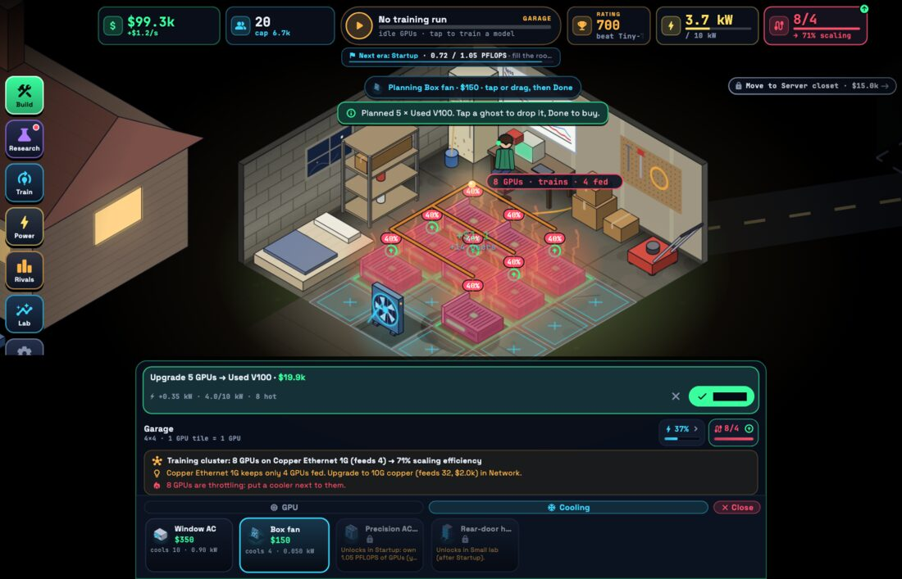
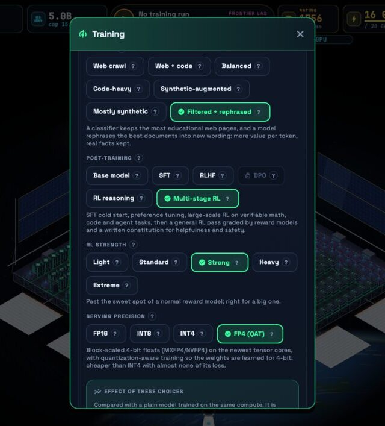
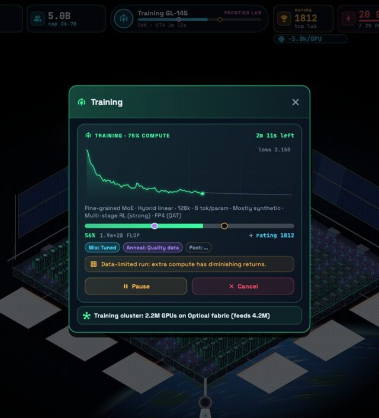
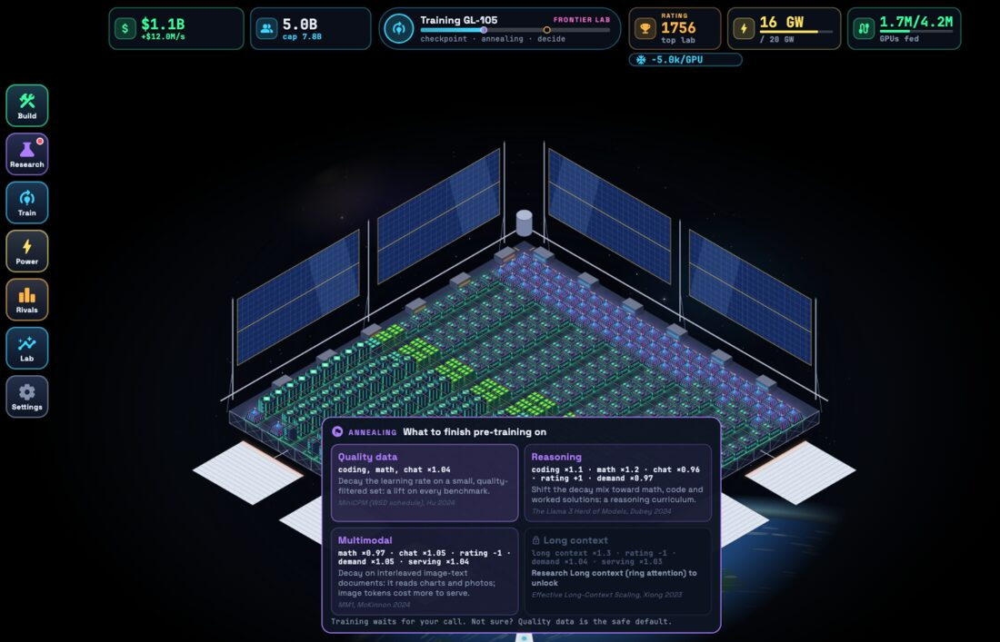
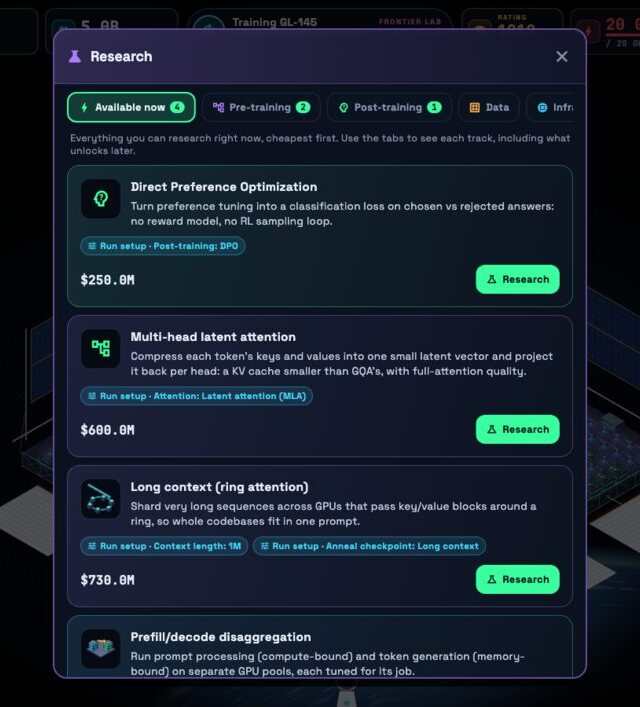
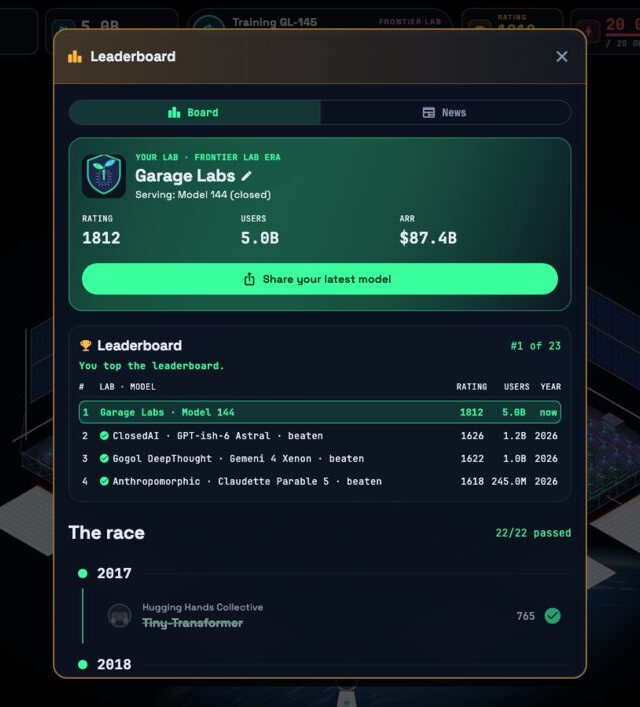
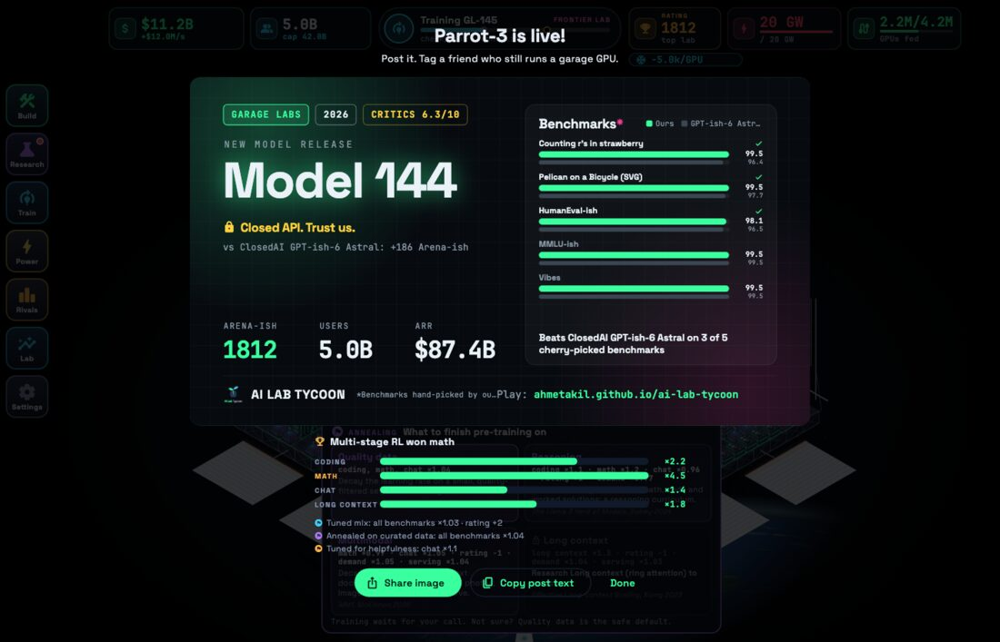
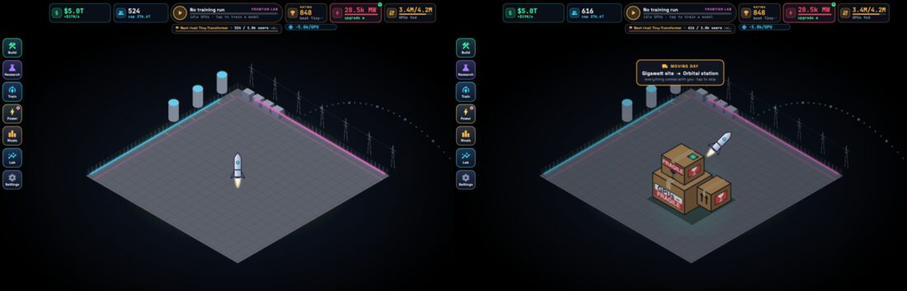

# AI Lab Tycoon

**Grow an AI lab from one used GPU in your parents' garage to a gigawatt datacenter, and then into orbit.**
Race parody versions of the big AI labs through 2017 → 2026 and design your own models.
Every upgrade is a real technique with a one-line, technically accurate explanation.

### ▶ [Play it in your browser](https://ahmetakil.github.io/ai-lab-tycoon/)

No install or sign-up needed, and it works on phones too. Your save stays in your browser.




---

## What it is

An active idle/tycoon game, closer to *Game Dev Tycoon* than to a clicker. A full run to the last rival takes
about **7 hours**. It runs on Flutter: web, iOS and Android from one codebase.

- **Seven places to outgrow:** garage → server closet → colocation cage → datacenter hall → datacenter campus →
  Gigawatt site → orbital station. Each room has to feel cramped before the next one makes sense, and moving day
  comes with a truck (or a rocket).
- **Real hardware, real scale:** what one tile stands for grows as you go, from a single GPU to an 8-GPU server,
  a rack, a pod of ~1k GPUs and finally a whole building. Hardware goes from a used RTX 2060 and an RTX 4090 through V100,
  A100, H100, B200 and Rubin to three made-up sci-fi generations: photonic stacks, superconducting cryo-logic vaults
  and solar-powered orbital modules.
- **Power, cooling and network are actual constraints:** GPUs throttle when they run hot, your power service caps
  the room, and a weak network fabric leaves GPUs idle during training.
- **Model design that follows the real recipe:** pick data mixtures, attention variants, MoE, context length,
  post-training (SFT → RLHF → DPO → RL on verifiable rewards) and serving precision (down to FP4).
  Choices unlock through research, and the best late-game design mirrors today's published frontier recipes.
- **Training checkpoints:** a run pauses at one third and two thirds and asks you to make a call (anneal on
  quality data? push reasoning? go multimodal?). It waits for you, with no timer.
- **Rivals calibrated on public data:** 22 parody labs (ClosedAI, Gogol DeepThought, Anthropomorphic, …) release
  models on a 2017–2026 timeline. Their compute and ratings come from sourced public estimates
  ([docs/research/rival_labs.md](docs/research/rival_labs.md)).
- **Launches with a shareable card:** each release gets cherry-picked benchmarks, critic scores and a
  share-image card.


## A look around

| Build mode: plan, then **Done** | Model design |
|---|---|
|  |  |
| **Training run** | **Checkpoint decision** |
|  |  |
| **Research** | **Rivals and the race** |
|  |  |




## How to play

1. **Train your first model.** Your GPU already serves a few users. Tap **Train**, then *Start training*, and the
   default design is fine to start with. A better model brings more users, and more users bring more money.
2. **Build.** Tap **Build** to enter build mode, then tap or drag on empty cells to plan GPUs and coolers. Nothing
   is bought until you tap **Done**, and you can pan around freely while planning.
   **Upgrade GPUs** plans swaps for you: it starts with your oldest cards and works up tier by tier while the money
   lasts.
3. **Watch heat, power and network.** Red percentages on tiles mean throttling, so add a cooler next to them. The
   ⚡ chip shows your power cap, which you can upgrade in **Power**. The fabric chip shows how many GPUs actually
   join a training run.
4. **Research** unlocks new hardware, efficiency tricks and model-design options. The *Available now* tab sorts
   everything you can buy, cheapest first.
5. **Fill the room, then move.** Each era has a goal shown under the top bar. Reaching it unlocks the next place;
   tap the **Move to …** button when you can afford it. Everything comes with you.
6. **Beat the rivals.** Release models that out-rate the next lab on the **Rivals** board. Beat all 22 to win,
   then keep going: the sci-fi hardware and the orbital station are post-game goals.

Tips: tap any tile for details, sell or swap. The game keeps earning a capped amount while you're away.
**Settings → Reset** starts a completely fresh run.

## Run it locally

Requires Flutter 3.29+ (Dart 3.7).

```sh
flutter pub get
flutter run -d chrome          # web
flutter run                    # iOS / Android device or simulator
```

Debug builds have a ×10 / ×60 speed toggle in Settings.

### Checks

```sh
flutter analyze
flutter test                                 # ~300 tests: sim, UI, layout at phone sizes, audio
dart run tool/balance_sim.dart 480 --seeds=1,2,3 --phases   # headless bot playthroughs → pacing table
LAYOUT_PREVIEW_DIR=/tmp/shots flutter test test/ui/layout_test.dart   # PNG screenshots of every screen
```

### Web build

```sh
flutter build web --release --base-href /ai-lab-tycoon/
```

Optional anonymous analytics (daily users, crashes) go to PostHog. They're off unless you pass a key at build time:
`--dart-define=POSTHOG_KEY=phc_... --dart-define=POSTHOG_HOST=https://eu.i.posthog.com`.

## How it's built

- **`lib/sim/`** is a pure, deterministic Dart simulation with no Flutter imports: content (hardware, rooms,
  research), balance knobs, game logic, save state, and a **bot** that plays the whole game headlessly.
  `tool/balance_sim.dart` runs that bot across seeds and prints when each era, room and rival lands, so balance
  changes are checked against a pacing table rather than by feel. [docs/BALANCE.md](docs/BALANCE.md) has the numbers.
- **`lib/ui/`** is the Flutter UI. Widgets read the game and change it only through `controller.act(...)`.
  The world is an isometric map with a camera, per-room art, tile sprites, heat and cable overlays and
  animated moving days.
- **All art is procedural:** Python scripts in `tool/art/` draw isometric SVG with a small shared toolkit
  (`iso.py`), rasterized with `rsvg-convert`. No image-generation model was used.
- **All audio is procedural too:** `tool/audio/generate_audio.py` synthesizes every sound effect and the music loop
  from oscillators and noise.
- **Docs:** [DESIGN.md](docs/DESIGN.md) (the game), [GRID.md](docs/GRID.md) (rooms, tiles, heat, power and network),
  [MODEL_DESIGN.md](docs/MODEL_DESIGN.md) (the model-design system) and
  [research/model_choices.md](docs/research/model_choices.md) (sources for each technique).

## Credits

Fonts: Space Grotesk and JetBrains Mono (SIL Open Font License). Art and audio are original and generated by
scripts in this repo. See [assets/CREDITS.md](assets/CREDITS.md).

All AI lab, company and model names are parodies. Real hardware product names (H100, B200, InfiniBand, NVLink…)
are used descriptively. This project isn't affiliated with or endorsed by any of them.
